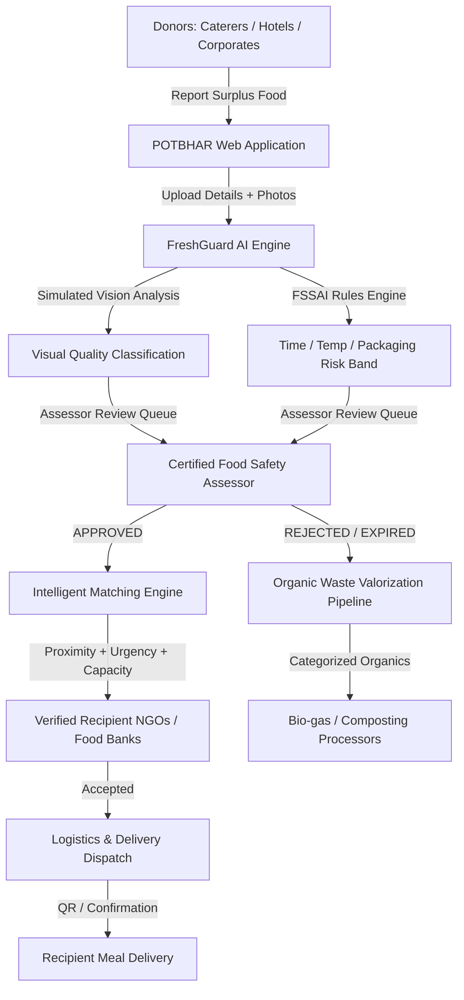

# 🍛 POTBHAR (पोटभर) — Surplus Food Redistribution & Zero Waste Platform
> **"Har Pet Bhare, Har Nivala Sambhale"**  
> *AI-Powered Food Quality Assessment, Hyperlocal Redistribution & Organic Waste Management*

---

## 🌟 Executive Summary

POTBHAR is a comprehensive, production-grade platform built to solve India's food waste and hunger paradox. While **190+ million people go undernourished** daily in India, over **68 million tonnes of food is wasted annually** from banquets, corporate cafeterias, and restaurants. 

POTBHAR tackles both sides of the equation:
1. **Edible Surplus Food Recovery**: Screened by **FreshGuard AI**, verified by certified food safety assessors, and routed to verified hunger-relief recipient organizations using proximity-weighted matching.
2. **Organic Waste Valorization**: Food deemed unsuitable for human consumption is diverted to verified composting and biogas processors with chain-of-custody tracking.
3. **Audited Transparency**: FSSAI-aligned audit trails, chain-of-custody tracking, and real-time impact metrics (meals served, kg recovered, CO₂ diverted).

---

## 🏗 System Architecture & Technology Stack



### Technology Stack
- **Frontend**: React 18, Vite 5, Tailwind CSS, Recharts, Lucide Icons, React Router v6
- **Backend**: FastAPI (Python 3.11), SQLAlchemy ORM, Pydantic v2, Python-Jose (JWT), SQLite (Dev) / PostgreSQL-ready
- **AI / ML Service**: **FreshGuard AI** — Multi-modal risk screening incorporating temperature exposure limits, food category decay rates, packaging integrity, and simulated visual defect classification
- **Security**: Role-Based Access Control (RBAC) across 6 roles, bcrypt-compatible salted SHA-256 password hashing, bearer JWT tokens

---

## 🚀 Running the Project Locally

Run the API and Vite frontend in separate terminals for local development:

### 1. Backend Server
```bash
cd potbhar/backend
# (Virtual environment or global Python 3.11)
python -m uvicorn app.main:app --host 127.0.0.1 --port 8000
```
- **API Base URL**: `http://127.0.0.1:8000/api/v1`
- **Interactive Swagger Docs**: `http://127.0.0.1:8000/docs`
- **ReDoc**: `http://127.0.0.1:8000/redoc`

### 2. Frontend Development Server
```bash
cd potbhar/frontend
npm run dev
```
- **Web App**: `http://localhost:5173/`

---

## 🔑 Pre-Seeded Demo Credentials

You can test every role in the platform using one-click quick login buttons on the login page or with the following credentials (all passwords: `demo123`):

| Role | Email | Password | Description & Access |
|---|---|---|---|
| **Donor** | `donor@potbhar.demo` | `demo123` | Green Feast Caterers — Report food batches, assess FreshGuard risk, report organic waste |
| **Recipient (NGO)** | `recipient@potbhar.demo` | `demo123` | Asha NGO Food Bank — Post food requirements, view & accept donation matches |
| **Food Assessor** | `assessor@potbhar.demo` | `demo123` | Food Safety Specialist — Review incoming batches, inspect FreshGuard flags, approve/reject |
| **Waste Processor**| `processor@potbhar.demo` | `demo123` | EcoCompost Delhi — Receive diverted organic waste batches and log compost/biogas yields |
| **System Admin** | `admin@potbhar.demo` | `demo123` | Platform Administrator — Organization verification, system-wide analytics, audit logs |

---

## 🧪 Verified Feature Checklist

- [x] **JWT Authentication & RBAC**: Donor, Recipient, Assessor, Processor, Admin roles.
- [x] **Food Batch Management**: Complete CRUD with preparation time, storage temperature, packaging integrity, and handling history completeness.
- [x] **FreshGuard AI Vision & Risk Assessment**: Rules-based quality risk screening with FSSAI-informed danger zone time limits and visual confidence scoring.
- [x] **Assessor Review Queue**: Human-in-the-loop approval workflow with mandatory decision rationale.
- [x] **Hyperlocal Matching Algorithm**: Haversine distance calculation, capacity constraints, urgency weighting, and top-3 recipient ranking.
- [x] **Recipient Offers & Requirements**: Real-time offer acceptance and dietary constraint filtering.
- [x] **Zero Waste Pipeline**: Organic waste batch creation, processor assignment, receipt confirmation, and biogas/compost output tracking.
- [x] **Platform Analytics & SDG Alignment**: Real-time counters for meals recovered, organic waste diverted, CO₂ offset, and active organizations.
- [x] **Responsive Premium UI**: Glassmorphic dark theme, intuitive layout, interactive badges, Recharts visualizations, and accessibility.

---

## 🌍 UN Sustainable Development Goals (SDG) Alignment

- **SDG 2 — Zero Hunger**: Rapid redistribution of quality-checked surplus food to undernourished communities.
- **SDG 11 — Sustainable Cities & Communities**: Localized routing reducing transit time and urban waste pile-up.
- **SDG 12 — Responsible Consumption & Production**: Prevention of edible food waste and complete diversion of non-edible organics.
- **SDG 13 — Climate Action**: Methane mitigation through composting and biogas generation instead of landfill disposal.

## Current app setup and deployment notes

The Vite application in the repository root is the active frontend. Start the API from `backend/` with `python -m uvicorn app.main:app --host 0.0.0.0 --port 8000`, then run `npm run dev` from the repository root. For a same-origin production deployment, keep `VITE_API_BASE_URL=/api/v1` and route `/api/v1` to the FastAPI service. If the frontend and API use separate domains, set `VITE_API_BASE_URL` to the API's `/api/v1` URL and set `FRONTEND_ORIGINS` on the API to the exact frontend origin(s), comma-separated.

Set `POTBHAR_SECRET_KEY` to a long random secret and `APP_ENV=production` in the backend deployment environment. The API refuses to start in production without the secret. Set `DATABASE_URL` to a persistent SQLite database file for a single-instance deployment. For PostgreSQL, configure its SQLAlchemy URL and install the matching database driver.

Demo sign-in password is `demo123`:

| Workspace | Email |
| --- | --- |
| Donor | `donor@potbhar.demo` |
| Rider | `rider@potbhar.demo` |
| Recipient | `recipient@potbhar.demo` |
| Compost Unit | `processor@potbhar.demo` |
| Admin | `admin@potbhar.demo` |

The donor, rider, recipient, compost, and admin workspaces are available through role sign-in. The shared workflow panel is backed by the API; older sample cards in each portal remain illustrative demo content.

## Deploying the shared live portal workflow

The public site is deployed on Netlify and the authenticated API/database are deployed as a separate Render service. `netlify.toml` builds the root Vite application, serves SPA routes, and proxies `/api/v1/*` to `https://potbhar-api.onrender.com`. `render.yaml` provisions the FastAPI service and PostgreSQL database; deploy the Blueprint first so the API host is available, then connect the Netlify site from this repository. If the generated Render service hostname changes, update the API proxy destination in `netlify.toml`.

The live workflow panel is included in each role portal. Donors publish offers from the donation form; recipients claim and inspect deliveries; riders confirm pickup and delivery; compost units confirm receipt and processing; donors and admins see the shared status. Portals poll the persistent API every three seconds, so updates appear across devices while signed in. Local demo fallback works without the API, but it cannot share updates between separate devices.

Set `FRONTEND_ORIGINS` on Render to the exact Netlify site and any custom domain, separated by commas. The default `FRONTEND_ORIGIN_REGEX` accepts Netlify subdomains. The API uses PostgreSQL in the Render Blueprint and a generated JWT secret. Demo accounts are seeded on first boot; rotate or disable public demo accounts before using the site for real operations. Netlify deploys the frontend only; the Render Blueprint must also be deployed for authentication and cross-device live workflows.
